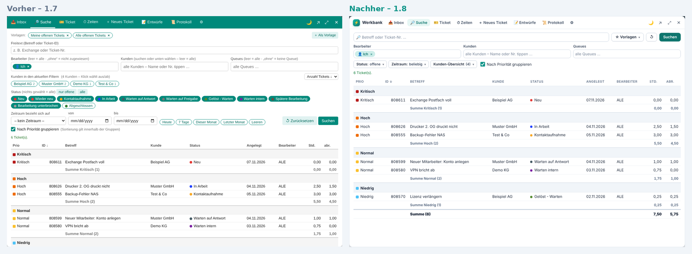
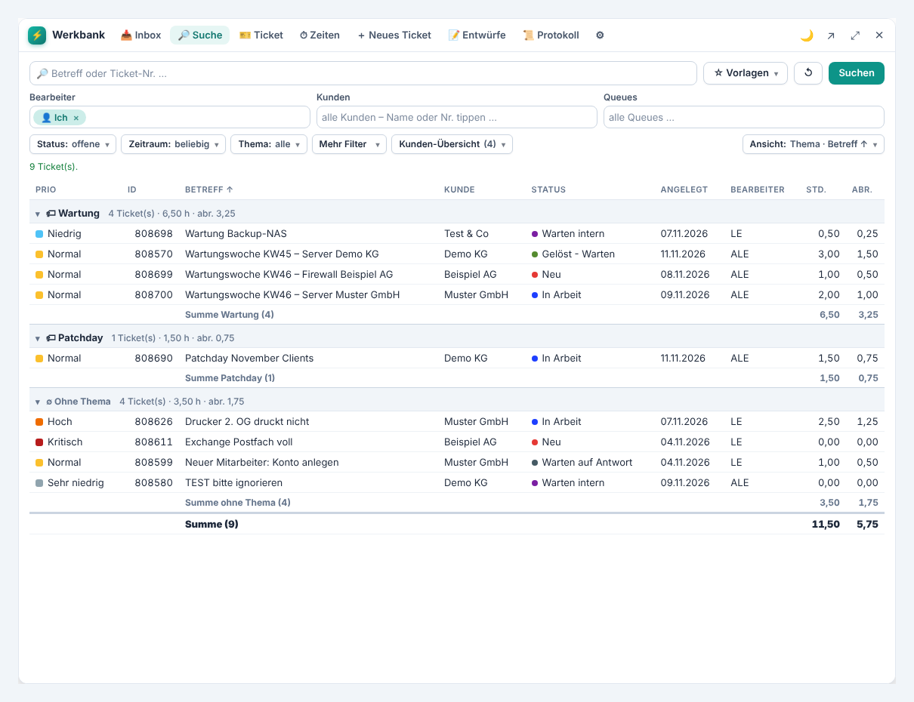
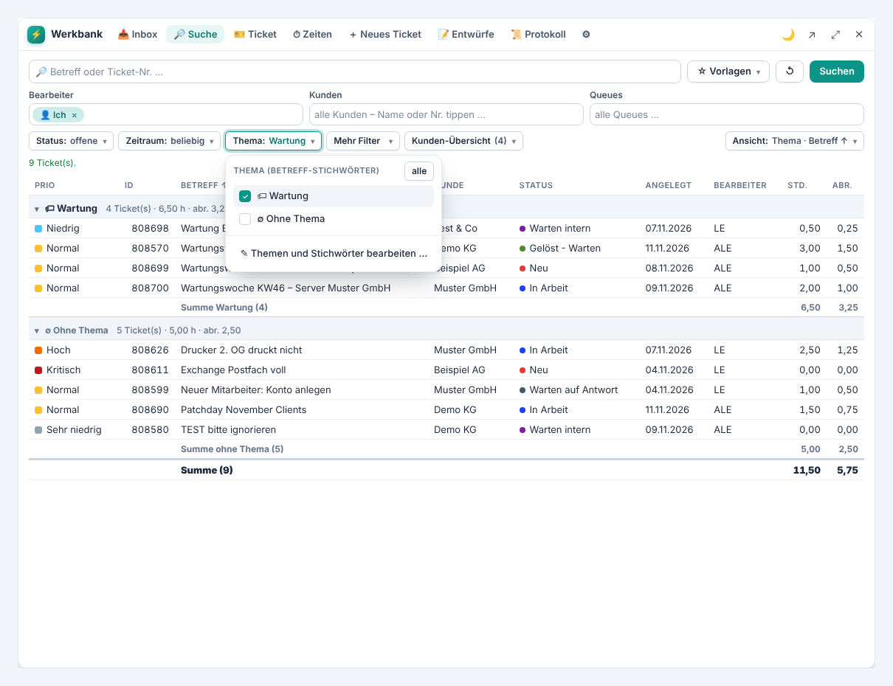
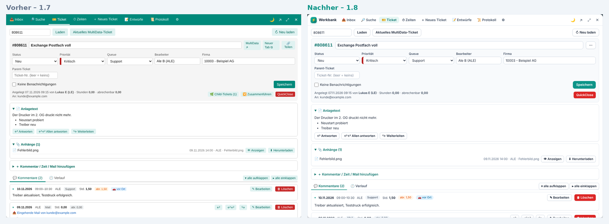
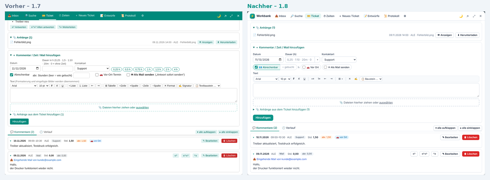
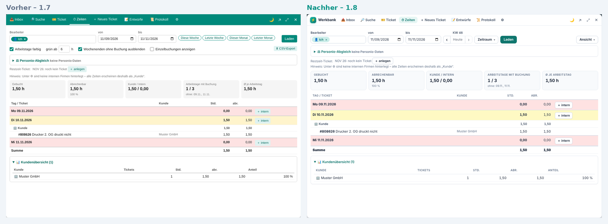
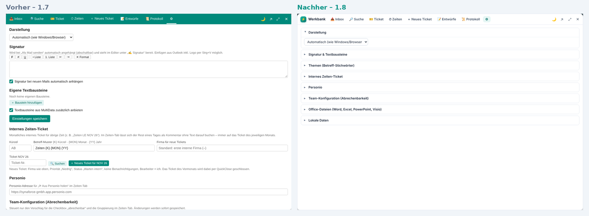
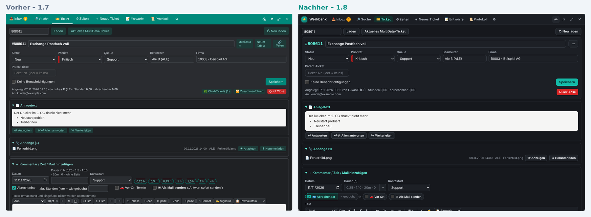

## MultiData Werkbank 1.8 – Neue, kompakte Oberfläche

Die Werkbank sieht moderner aus und ist deutlich aufgeräumter. **Alle Funktionen, Tastenkürzel und gespeicherten Einstellungen bleiben erhalten.** Sie sind nur übersichtlicher angeordnet.

### Neu
- **Neues Design:** neue Kopfzeile mit Reitern als Pillen, ruhigere Farben, klare Fokus-Rahmen, überarbeiteter Dark Mode.
- **Kompakter:** geringere Abstände und Feldhöhen. Seltener genutzte Optionen stecken in Aufklappmenüs, deren Knopf die aktuelle Auswahl zeigt (z. B. „Status: offene“). Weicht ein Filter von „alle“ ab, ist der Knopf farbig hervorgehoben.
- **Suche:** ☆ Vorlagen, Status, Zeitraum und Kunden-Übersicht als Menüs; ↺ setzt die Filter zurück.
- **Themen und Gruppieren in der Suche:** Eigene **Themen** mit Stichwörtern im Betreff (z. B. „Wartung“: *Wartungswoche; Wartung*) lassen sich unter ⚙ anlegen. In der Suche gibt es den Filter **Thema** (inkl. „Ohne Thema“) und **Mehr Filter** (Priorität, *Betreff enthält nicht*). Das Menü **Ansicht** gruppiert nach Priorität, Thema, Status, Kunde oder Bearbeiter und sortiert nach jeder Spalte, z. B. nach Betreff. Gruppen zeigen Anzahl und Stunden und lassen sich per Klick einklappen. Vorlagen speichern Thema, Gruppierung und Sortierung mit.
- **Favoritenleiste:** Favorisierte Suchvorlagen (★ im Menü ☆ Vorlagen) erscheinen als Knopfleiste über der Suche, so wechselt man mit einem Klick zwischen ihnen. Abschaltbar unter ⚙ → Darstellung.
- **Ticket:** Das Menü **⋯** enthält In MultiData öffnen, In neuem Tab, 🔗 Link kopieren (früher „Teilen“), Child-Tickets und Zusammenführen.
- **Buchen:** Die Dauer-Schnellwahl steckt im ▾ am Dauer-Feld. *Abrechenbar*, *Vor Ort* und *Als Mail senden* sind Umschalt-Pillen; die abrechenbaren Stunden stehen direkt an der Abrechenbar-Pille.
- **Texteditor:** Die Tabellen-Befehle stecken im Menü ⊞ ▾, die übrigen Knöpfe sind Symbole mit Tooltip.
- **Zeiten:** Der Tab lädt beim Öffnen automatisch die **aktuelle Woche**. Mit **‹ Heute ›** blättert man wochenweise, darüber steht die Kalenderwoche. Ansicht und CSV-Export sind im Menü „Ansicht“.
- **Inbox:** Die Typen sind ein Menü.
- **Einstellungen:** Die Abschnitte lassen sich einklappen, die Werkbank merkt sich, welche offen sind.

### Vorher / Nachher
*(Beispieldaten)*

**Suche**

**Neu: Wartungen zusammengefasst – nach Thema gruppiert, nach Betreff sortiert**

**Neu: Filter „Thema“**

**Ticket**

**Kommentar / Zeit buchen**

**Zeiten**

**Einstellungen**

**Dark Mode**

